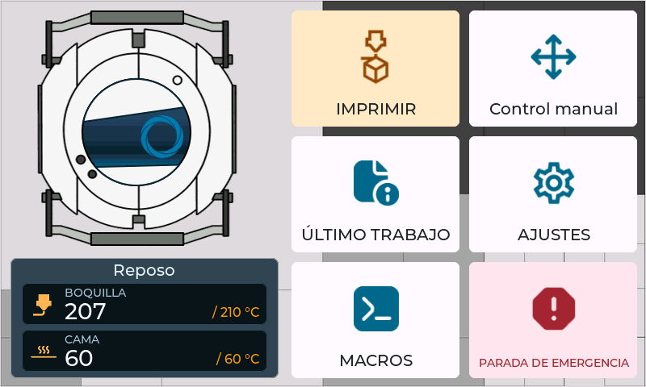

# KLIPPER_JC4880P443_SOLID

Firmware para usar el panel táctil **Guition JC4880P443C (ESP32-P4)** como interfaz de una impresora 3D con Klipper y Moonraker. La interfaz PORTAL usa LVGL en horizontal a **800 × 480** y se conecta a Moonraker por Wi-Fi.

## Diseño

| Pantalla principal | Salvapantallas durante la impresión |
| --- | --- |
|  |  |

*Capturas del simulador LVGL con datos de ejemplo.*

La pantalla principal combina un fondo gris geométrico, iconos de color y un core cuya expresión indica el estado de Klipper. El ojo y los párpados pasan por nueve poses en las pantallas con core y en el salvapantallas. Durante una impresión, el salvapantallas muestra el progreso, los tiempos y las temperaturas con textos atenuados.

En **Ajustes** puedes probar el salvapantallas, elegir 1, 5 o 10 minutos de inactividad y configurar su brillo por separado. El brillo inicial del salvapantallas es del 25 %. El primer toque restaura el brillo normal y se consume al despertar la pantalla.

## Funciones

- **Impresión.** Selecciona un G-code reciente, consulta su miniatura y envíalo a imprimir. La vista muestra el estado confirmado por Klipper. Durante el trabajo puedes pausar, reanudar, cancelar, excluir objetos desde el mapa y ajustar velocidad, flujo y ventilador de capa.
- **Control manual.** Consulta las posiciones absolutas de X, Y y Z, mueve los ejes por pasos y ejecuta HOME por eje o para todos. Ajusta la temperatura de boquilla y cama, aplica perfiles PLA, PETG, TPU o ABS y enfría ambos calentadores. En pausa están disponibles la extrusión y la retracción de 50 mm.
- **Macros y último trabajo.** Ejecuta macros públicas y consulta el resultado, la miniatura, el tiempo estimado y el consumo de filamento cuando estén disponibles.
- **Conexión y alertas.** Configura Wi-Fi, la dirección y el puerto de Moonraker desde **Ajustes**, también al imprimir o estar en pausa. La pantalla de error presenta el diagnóstico completo de Klipper en un área desplazable. El panel incluye parada de emergencia, reinicio de Klipper y apagado del equipo anfitrión.
- **Sonido y diagnóstico.** El saludo de GLaDOS y los efectos de Portal acompañan los estados y las acciones del panel. Puedes ajustar o silenciar el volumen. La consola USB permite consultar la conexión, inspeccionar pantallas y medir el rendimiento.

En OrcaSlicer puedes configurar las miniaturas como `100x100/PNG,300x300/PNG`. El panel prefiere la de 300 × 300, hasta 128 KiB.

## Compilación y conexión

El proyecto ESP-IDF está en [final/](final/). Usa **ESP-IDF 5.5.6** y **LVGL 9.3.0**. Con el entorno de ESP-IDF activado, compila desde la raíz del repositorio:

```powershell
Set-Location final
idf.py build
```

En el panel, abre **Ajustes → Wi-Fi y Moonraker** para seleccionar la red, indicar la IP y el puerto del servidor y probar la conexión. Moonraker debe autorizar al panel en la red local. La conexión usa HTTP y WebSocket.

## Documentación

- [Cliente Klipper y Moonraker](final/docs/klipper_backend.md)
- [Recursos gráficos](final/docs/assets-portal.md)
- [Simulador Moonraker](final/docs/moonraker-falso.md)
- [Pruebas de interfaz LVGL](final/tests/portal_host/README.md)

La compilación y las pruebas de simulación pasan. Queda pendiente verificar el brillo y la fluidez del salvapantallas en el panel físico.

Iconos de **Uicons by Flaticon**, **Pictogrammers**, **Google Material Symbols** y **Lucide/Feather**. [Atribuciones y licencias](final/docs/assets-portal.md#fuentes-y-reproducción)
